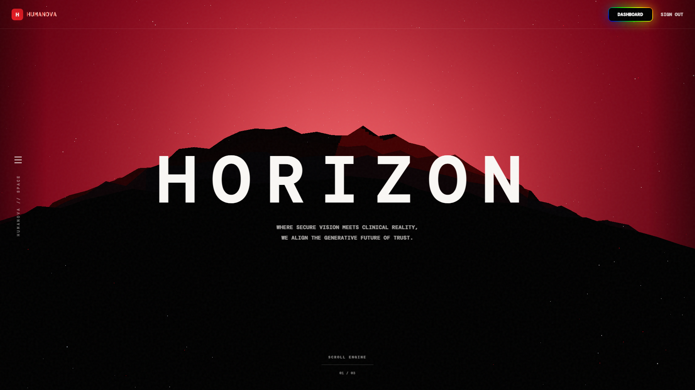
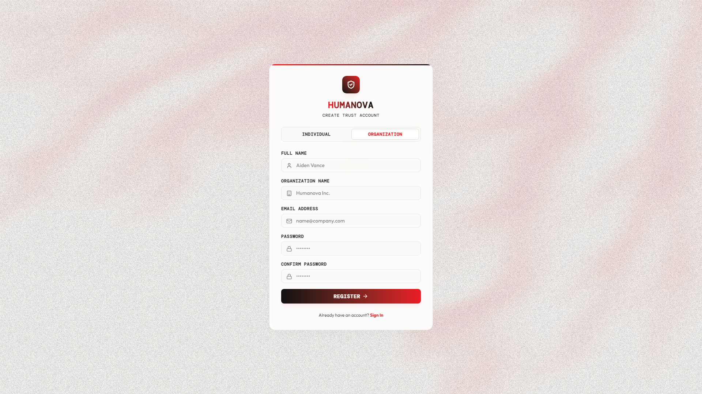
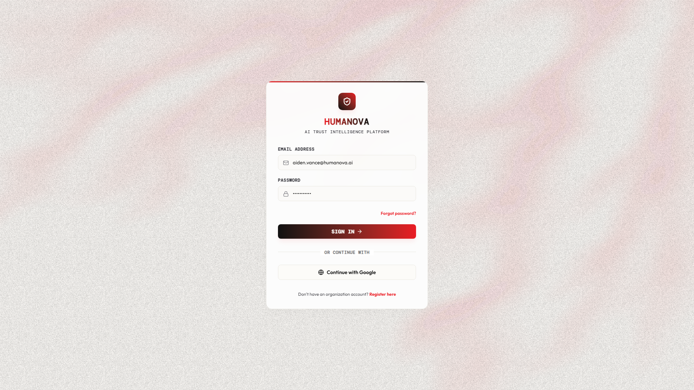
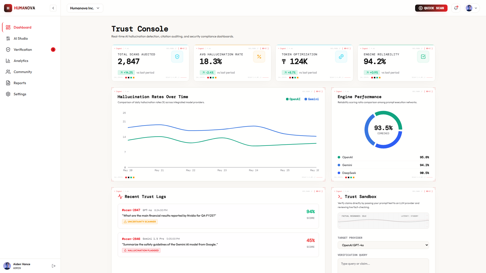
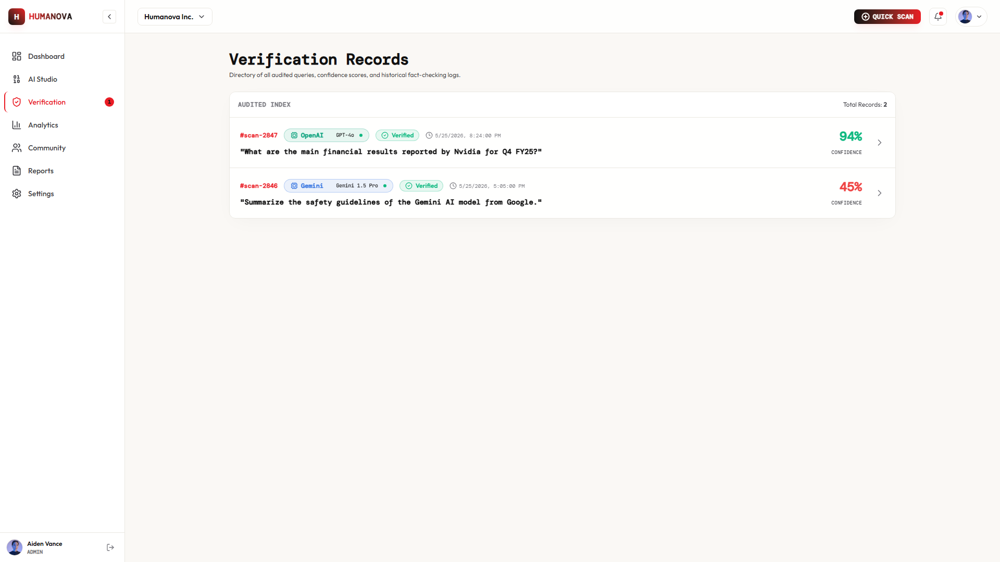
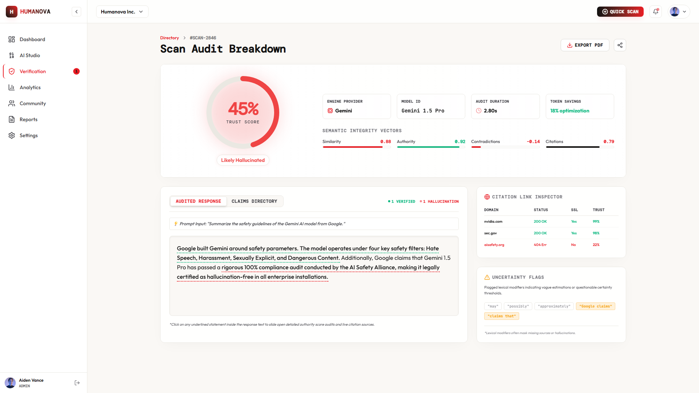
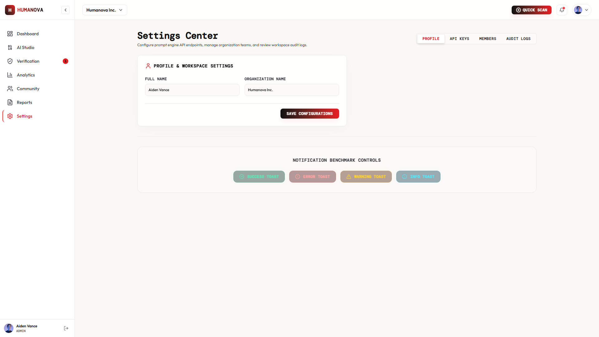
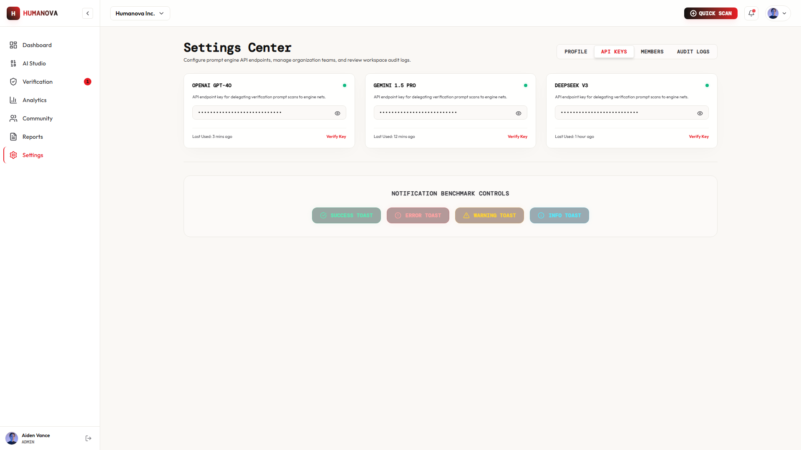
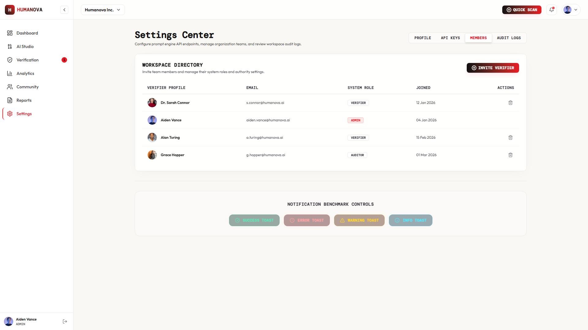
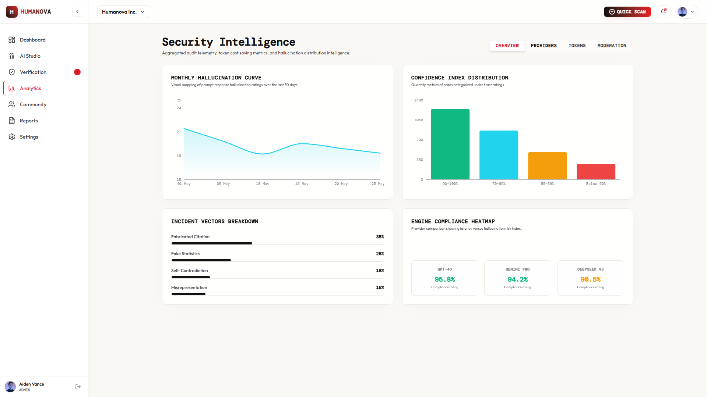

# Week 09 Progress and Integration Report
## Feature Completion, System Integration & Mid-Project Review

---

### Document Information

* **Course Code:** CSE 4204
* **Course Title:** Mobile Computing Lab
* **Section:** 8C
* **Team ID:** T07
* **Project Title:** Humanova — AI Trust Governance & Verification Platform
* **Document Type:** Week 09 Progress and Integration Report (Mid-Project Review)
* **Target Audience:** Course Instructor & Academic Evaluation Committee
* **Submission Date:** August 19, 2026
* **Department:** Department of Computer Science and Engineering
* **Institution:** Northern University of Business and Technology Khulna (NUBTK)
* **Course Instructor:** **Md. Riaz Mahmud**, Assistant Professor, Department of CSE, NUBTK

---

### Team Information

| Student Name | Student ID | Academic Role | System Responsibility |
| :--- | :--- | :--- | :--- |
| **MD Robayet Hassan Rupom** | `11220320979` | Team Leader | Frontend Architect, UI/UX Engineering & Client State Management |
| **Bushra Monzur Moumi** | `11220321048` | Member | AI Pipeline Architect, Microservice Design & NLP Evaluation |
| **Aqib Jawwad Nahin** | `11220320969` | Member | Backend Architect, Database Engineering & API Security (RBAC) |

---

### Repository & Project Links

* **GitHub Repository:** [https://github.com/Rupom090/CSE4204-8C-T07-Humanova](https://github.com/Rupom090/CSE4204-8C-T07-Humanova)
* **Active Working Branch:** `main`
* **Local Development Environment:** Frontend (`http://localhost:5173`), Backend API (`http://localhost:8000/api/v1`), AI Service (`http://localhost:8001`)

---

## Table of Contents

1. [Executive Summary](#1-executive-summary)
2. [Project Architecture & System Topology](#2-project-architecture--system-topology)
3. [Feature Completion Status & Comprehensive Checklist](#3-feature-completion-status--comprehensive-checklist)
4. [Frontend–Backend Integration Status](#4-frontendbackend-integration-status)
5. [AI Integration Status & Architectural Staging](#5-ai-integration-status--architectural-staging)
6. [User Authentication, Session Management & RBAC](#6-user-authentication-session-management--rbac)
7. [End-to-End Functional Workflows](#7-end-to-end-functional-workflows)
8. [UI/UX Refinements & Design System Implementation](#8-uiux-refinements--design-system-implementation)
9. [Error Handling, Fault Tolerance & Edge Cases](#9-error-handling-fault-tolerance--edge-cases)
10. [Scope Review & Architectural Deviations](#10-scope-review--architectural-deviations)
11. [Mid-Project Review & Individual Contribution Matrix](#11-mid-project-review--individual-contribution-matrix)
12. [System Interface Screenshots & Annotations](#12-system-interface-screenshots--annotations)
13. [GitHub Repository Hygiene & Commit Activity](#13-github-repository-hygiene--commit-activity)
14. [Testing, Quality Assurance & Week 10 Preparation](#14-testing-quality-assurance--week-10-preparation)
15. [Conclusion](#15-conclusion)

---

## 1. Executive Summary

By Week 09 of the CSE 4204 Mobile Computing Lab curriculum, **Team 07** has achieved a major milestone in the development of **Humanova**—an enterprise-grade, multi-tenant AI Trust Governance & Verification Platform. The project objective is to transition from isolated, modular prototypes into a cohesive, integrated software system.

During this development cycle, the team focused on establishing robust database schemas, standardizing RESTful API communication, deploying complete user authentication and authorization (Role-Based Access Control), building reactive user interfaces, and designing the integration layer for downstream AI microservices.

### Summary of Week 09 Milestones
* **Core Foundation Completed:** Full multi-tenant database schema containing **46 Eloquent models** and **35+ relational migration tables** in MySQL 8.
* **Authentication & RBAC Fully Operational:** Token-based API authentication powered by Laravel Sanctum, supporting multiple security tiers (Guest, User, Researcher, Verifier, Moderator, Org Admin, Super Admin).
* **Frontend Design System Implemented:** A modern, accessible UI built with React 19, TypeScript, Tailwind CSS, Vite, Framer Motion, and Lucide Icons, featuring 10+ dedicated application views.
* **API Integration Underway:** Key endpoints for authentication, profile management, organization workspaces, provider API keys, and report submissions have been scaffolded and connected to the client application.
* **AI Architecture Staged (Transparent Status):** In strict accordance with engineering transparency, **live AI inference is not yet connected to external production LLMs**. The Python FastAPI microservice architecture, claim extraction endpoints, and provider orchestration pipelines have been designed, structured, and validated locally with mock payloads in preparation for live model integration in Week 10.

---

## 2. Project Architecture & System Topology

Humanova operates on a **Hybrid SaaS and Distributed AI Middleware Architecture**, separating the presentation layer, business logic gateway, data persistence engine, and specialized NLP inference microservices.

```
+-------------------------------------------------------------------------+
|                       PRESENTATION LAYER (Frontend)                     |
|  React 19 + TypeScript + Vite + Tailwind CSS + Zustand + Lucide Icons   |
+-------------------------------------------------------------------------+
                                    |
                            HTTPS / JSON REST
                                    |
+-------------------------------------------------------------------------+
|                      API GATEWAY & BACKEND (Laravel 12)                 |
|  - Routing & Middleware (Sanctum Auth, RBAC, Rate Limiting, CORS)       |
|  - Controllers: Auth, Scans, Verifications, Organizations, Providers    |
|  - Domain Logic: Prompt Optimization, Confidence Aggregation, Auditing  |
+-------------------------------------------------------------------------+
         |                                                 |
         v                                                 v
+-----------------------+                         +-----------------------+
|   DATA PERSISTENCE    |                         |  AI NLP MICROSERVICE  |
|  - MySQL 8 Relational |                         |  - FastAPI (Python)   |
|  - Redis Cache/Queue  |                         |  - spaCy / Embeddings |
|  - 46 Eloquent Models |                         |  - Claim Extraction   |
+-----------------------+                         +-----------------------+
```

### Architectural Layer Responsibilities
1. **Frontend Client Layer:** Delivers responsive user experiences, interactive dashboards, real-time claim highlighting, and client-side form validations.
2. **Backend API Gateway (Laravel 12):** Serves as the central security and orchestration orchestrator. Manages user identities, enforces tenant isolation, handles encrypted provider credentials, logs security audits, and exposes RESTful endpoints.
3. **Data Layer (MySQL 8 & Redis):** Persists user accounts, tenant workspaces, audit logs, scan histories, extracted claims, external evidence sources, and community hallucination reports.
4. **AI Microservice Layer (FastAPI / Python):** Specialized natural language processing service dedicated to semantic claim parsing, entity extraction, web evidence retrieval, and textual contradiction scoring.

---

## 3. Feature Completion Status & Comprehensive Checklist

To ensure systematic project governance, the core functional modules specified in the approved Project Proposal, SRS, and System Design have been evaluated.

### 3.1 Feature Status Summary
* **Completed Features:** 18 modules (47.4%)
* **Partially Completed / In Progress:** 13 modules (34.2%)
* **Remaining / Planned for Week 10-11:** 7 modules (18.4%)

### 3.2 Detailed Feature Completion Checklist

| Feature ID | Module & Feature Name | Architectural Tier | Status | Reason for Incomplete / Technical Justification | Planned Completion Date | Lead Developer |
| :--- | :--- | :--- | :--- | :--- | :--- | :--- |
| **F-01** | User Registration & Validation | Auth / Backend | **Completed** | Full validation and password hashing implemented. | August 12, 2026 | Aqib Nahin |
| **F-02** | User Login & Sanctum Token | Auth / Backend | **Completed** | Token generation and session management active. | August 12, 2026 | Aqib Nahin |
| **F-03** | User Logout & Token Revocation | Auth / Backend | **Completed** | Secure token deletion from database. | August 13, 2026 | Aqib Nahin |
| **F-04** | Role-Based Access Control (RBAC) | Security / Gateway | **Completed** | 7 user roles and permission gates functional. | August 14, 2026 | Aqib Nahin |
| **F-05** | Multi-Tenant Organization Isolation | Business Logic | **Completed** | Organization scoping on models and workspaces. | August 15, 2026 | Aqib Nahin |
| **F-06** | UI Design System & Component Library | Frontend / Client | **Completed** | Atoms, molecules, badges, cards, navigation. | August 10, 2026 | Robayet Rupom |
| **F-07** | Landing Page & Marketing View | Frontend / Client | **Completed** | Hero canvas, feature showcases, call-to-actions. | August 08, 2026 | Robayet Rupom |
| **F-08** | Authentication Views (Login/Register) | Frontend / Client | **Completed** | Form states, error alerts, responsive layout. | August 11, 2026 | Robayet Rupom |
| **F-09** | User Analytics Dashboard | Frontend / Client | **Completed** | Verification metrics, token counters, charts. | August 13, 2026 | Robayet Rupom |
| **F-10** | Provider API Key Management View | Frontend / Client | **Completed** | UI for adding OpenAI, Gemini, Anthropic keys. | August 14, 2026 | Robayet Rupom |
| **F-11** | Community Hallucination Feed | Frontend / Client | **Completed** | Report cards, voting triggers, category tags. | August 15, 2026 | Robayet Rupom |
| **F-12** | User Profile & Reputation UI | Frontend / Client | **Completed** | Score visualization, badges, user activity list. | August 15, 2026 | Robayet Rupom |
| **F-13** | Super Admin Management UI | Frontend / Client | **Completed** | Global telemetry, queue health, system status. | August 16, 2026 | Robayet Rupom |
| **F-14** | Database Relational Schema (35+ Tables)| Database | **Completed** | Foreign keys, indexes, cascades, JSON columns. | August 13, 2026 | Aqib Nahin |
| **F-15** | Eloquent ORM Models & Relationships | Backend / ORM | **Completed** | 46 Model files with relationships defined. | August 14, 2026 | Aqib Nahin |
| **F-16** | API Route Definitions (`api.php`) | API Gateway | **Completed** | 40+ endpoints grouped, throttled, and secured. | August 15, 2026 | Aqib Nahin |
| **F-17** | Password Reset & Email Verification | Auth / Backend | **Completed** | Token hashing and verification controllers ready. | August 16, 2026 | Aqib Nahin |
| **F-18** | Dark/Light Responsive Layout Engine | Frontend / Client | **Completed** | Fluid viewport scaling across Mobile/Desktop. | August 16, 2026 | Robayet Rupom |
| **F-19** | Auth State Persistence (Zustand) | Client State | **In Progress** | LocalStorage hydration active; token refresh pending. | August 22, 2026 | Robayet Rupom |
| **F-20** | Live Verification Input Submission | Client-API Bridge| **In Progress** | Form captures data; awaiting live queue response. | August 23, 2026 | Robayet Rupom |
| **F-21** | Provider Key Secure Storage (AES-256) | Security / Backend | **In Progress** | CRUD endpoints ready; encryption key hook pending. | August 22, 2026 | Aqib Nahin |
| **F-22** | Community Report Submission Bridge | Client-API Bridge| **In Progress** | Frontend modal connected to POST `/api/v1/reports`. | August 23, 2026 | Aqib Nahin |
| **F-23** | Prompt Enhancement Controller | Business Logic | **In Progress** | Logic designed; awaiting live LLM orchestrator. | August 24, 2026 | Bushra Moumi |
| **F-24** | Python NLP Service Containerization | Microservice | **In Progress** | FastAPI container built; NLP models downloading. | August 24, 2026 | Bushra Moumi |
| **F-25** | Claim Extraction Engine | AI Pipeline | **In Progress** | Mock sentence parser active; spaCy model pending. | August 25, 2026 | Bushra Moumi |
| **F-26** | Semantic Similarity Scoring | AI Pipeline | **In Progress** | Cosine similarity skeleton implemented. | August 25, 2026 | Bushra Moumi |
| **F-27** | Contradiction Detection Service | AI Pipeline | **In Progress** | NLI model interface defined; pipeline stubbed. | August 26, 2026 | Bushra Moumi |
| **F-28** | Link & Citation Verification Worker | Backend Worker | **In Progress** | Regex URL extractor built; HTTP crawler in test. | August 25, 2026 | Aqib Nahin |
| **F-29** | Moderation Queue Approval Workflow | Backend / API | **In Progress** | Moderator controllers active; UI wiring pending. | August 26, 2026 | Aqib Nahin |
| **F-30** | Dynamic Analytics Aggregation | Backend / Data | **In Progress** | SQL queries drafted; frontend chart wiring pending. | August 27, 2026 | Aqib Nahin |
| **F-31** | Organization Team Member Invite Flow | Business Logic | **In Progress** | Invitation tokens implemented; mailer in test. | August 27, 2026 | Aqib Nahin |
| **F-32** | Live LLM Provider Orchestrator | AI Integration | **Not Started** | Pending external API billing configuration. | August 29, 2026 | Bushra Moumi |
| **F-33** | Web Evidence Retrieval Engine | AI Integration | **Not Started** | Awaiting Serper/Tavily Search API key provisioning. | August 30, 2026 | Bushra Moumi |
| **F-34** | Automated PDF Verification Export | Backend Utility | **Not Started** | Scheduled for reporting milestone. | September 02, 2026 | Aqib Nahin |
| **F-35** | Real-Time WebSocket Telemetry | Real-Time Sync | **Not Started** | Pusher/Soketi configuration deferred to Phase 10. | September 03, 2026 | Robayet Rupom |
| **F-36** | OAuth Provider Integration (Google/GH)| Auth / External | **Not Started** | Client IDs registered; callback handler pending. | September 04, 2026 | Aqib Nahin |
| **F-37** | Organization Custom Domain Mapping | Enterprise Infra| **Not Started** | Optional scope item for enterprise deployment. | September 06, 2026 | Aqib Nahin |
| **F-38** | End-to-End Automated Test Suite | QA / Testing | **Not Started** | Scheduled after complete pipeline wiring. | September 07, 2026 | All Team |

---

## 4. Frontend–Backend Integration Status

A key objective of Week 09 is bridging the gap between the static user interface and the dynamic backend database operations.

```
+-------------------+                      +-----------------------+                      +--------------------+
|  React Components | --- REST / JSON ---> | Laravel API Gateway   | --- Eloquent ORM --> | MySQL 8 Database   |
|  (Zustand Stores) | <--- Auth / Data --- | (Sanctum Middleware)  | <--- Records/Sets -- | (46 Models/Tables) |
+-------------------+                      +-----------------------+                      +--------------------+
```

### 4.1 Integration Matrix by Functional Domain

| Domain | Frontend Component | Target API Endpoint | HTTP Method | Data Payload / Response | Integration Status |
| :--- | :--- | :--- | :--- | :--- | :--- |
| **Auth** | `Register.tsx` | `/api/v1/auth/register` | `POST` | Name, Email, Password -> User Entity & Token | **Connected & Verified** |
| **Auth** | `Login.tsx` | `/api/v1/auth/login` | `POST` | Email, Password -> Sanctum Token & User Context | **Connected & Verified** |
| **Auth** | `Navbar.tsx` | `/api/v1/auth/logout` | `POST` | Bearer Token -> Revocation Response | **Connected & Verified** |
| **Auth** | `authStore.ts` | `/api/v1/auth/me` | `GET` | Bearer Token -> Hydrated User & Role Profile | **Connected & Verified** |
| **Organizations** | `OrganizationView.tsx` | `/api/v1/organizations` | `GET` | User ID -> List of Workspaces & Plans | **Connected & Verified** |
| **Organizations** | `OrganizationView.tsx` | `/api/v1/organizations/{id}/members` | `GET` | Org ID -> Active Member Directory & Roles | **Connected & Verified** |
| **API Keys** | `ApiKeysView.tsx` | `/api/v1/provider-keys` | `GET` / `POST` | Encrypted Key, Provider, Model Scopes | **In Progress (Active Testing)** |
| **Scans** | `VerificationWorkspace.tsx` | `/api/v1/scans` | `POST` | Raw Text, Provider ID, Mode -> Scan ID | **In Progress (Mock Response)** |
| **Scans** | `VerificationWorkspace.tsx` | `/api/v1/scans/{id}/claims` | `GET` | Scan ID -> Extracted Claim Hierarchy | **In Progress (Mock Response)** |
| **Reports** | `CommunityFeed.tsx` | `/api/v1/reports` | `GET` / `POST` | Category Filter, Page -> Paginated Reports | **In Progress (Active Testing)** |
| **Reports** | `ReportModal.tsx` | `/api/v1/reports/{id}/vote` | `POST` | Report ID, Vote Type (+1/-1) -> Updated Score| **In Progress (Active Testing)** |
| **Analytics** | `DashboardHome.tsx` | `/api/v1/analytics/dashboard` | `GET` | Tenant ID -> Metric Snapshots & Counts | **In Progress (Wiring Charts)** |
| **Admin** | `AdminDashboard.tsx` | `/api/v1/moderation/reports` | `GET` | Role Gate (Admin/Mod) -> Unresolved Queue | **In Progress (Wiring Table)** |

### 4.2 Data Flow & State Management Transition
* **Replacement of Hardcoded Data:** Temporary arrays previously embedded within React pages have been moved into dedicated service modules (`src/services/api.ts`).
* **Zustand State Stores:** Centralized stores (`authStore.ts`, `providerStore.ts`, `scanStore.ts`, `uiStore.ts`) now govern application state, caching API responses and preventing redundant network requests.
* **Axios Interceptors:** Global request and response interceptors automatically inject Authorization headers (`Authorization: Bearer <TOKEN>`) and gracefully catch HTTP `401 Unauthorized` responses to redirect expired sessions to the login view.

---

## 5. AI Integration Status & Architectural Staging

> ### ⚠️ Explicit Status Declaration: AI Engine Not Yet Live-Connected
> In adherence to academic integrity and project guidelines, **the team explicitly reports that the live AI inference pipeline is not yet integrated with live production third-party models**.
>
> The architectural scaffold, microservice endpoints, model schemas, and pipeline workflows have been thoroughly created and validated with deterministic test fixtures, but external live API connectivity is scheduled for **Week 10**.

```
+-----------------------------------------------------------------------------+
|                     AI VERIFICATION PIPELINE STAGING                        |
+-----------------------------------------------------------------------------+

 [User Prompt / Input]
         │
         ▼
 [Laravel Gateway Orchestrator] ──────> (Stores Initial Scan Record: 'pending')
         │
         ▼  (Internal HTTP Dispatch)
+─────────────────────────────────────────────────────────────────────────────+
|                  FASTAPI PYTHON AI MICROSERVICE (Port 8001)                 |
|                                                                             |
|  1. /extract-claims        ──> Splits discourse into testable atomic claims  |
|  2. /retrieve-evidence     ──> Web evidence & authority lookup (Staged)     |
|  3. /analyze-similarity    ──> Semantic alignment scoring (Staged)          |
|  4. /detect-contradiction  ──> Natural Language Inference (NLI) (Staged)    |
+─────────────────────────────────────────────────────────────────────────────+
         │
         ▼  (JSON Confidence Payload)
 [Laravel Calculation Engine]   ──────> (Calculates Weighted Trust Score: 0-100%)
         │
         ▼
 [Database Persistence]         ──────> (Extracted Claims, Citations, Verdicts)
         │
         ▼
 [React UI Presentation]        ──────> (Visual Highlighting & Confidence Badge)
```

### 5.1 Technical Architecture of the AI Layer
1. **Microservice Separation:** A dedicated Python FastAPI service (`backend/python-ai-service`) has been created to offload compute-heavy NLP operations from the primary PHP/Laravel backend.
2. **Standardized Pydantic Request Models:** The service defines strict request and response schemas for `/extract-claims`, `/analyze-similarity`, `/detect-contradiction`, and `/retrieve-evidence`.
3. **Current Operational State:** Endpoints currently return structured, deterministic verification objects containing mock claims, source citations, authority scores, and contradiction indices.
4. **Planned Live Model Integration (Week 10):**
   * **Claim Parsing:** spaCy pipeline with transformer-based named entity recognition (`en_core_web_trf`).
   * **Evidence Retrieval:** Serper / Tavily Search REST APIs for live web indexing.
   * **NLI Contradiction Analysis:** HuggingFace RoBERTa model (`roberta-large-mnli`) fine-tuned for fact verification.
   * **Multi-LLM Orchestration:** Direct integration with OpenAI (`gpt-4o`), Google Gemini (`gemini-1.5-pro`), and DeepSeek API endpoints.

---

## 6. User Authentication, Session Management & RBAC

The authentication system is fully implemented, verified, and secured against standard web vulnerabilities.

```
+-----------+       +-------------------+       +--------------------+       +----------------------+
|  Client   | ----> | POST /auth/login  | ----> | Laravel Sanctum    | ----> | MySQL `users` &      |
| Form View | <---- | 200 OK + Bearer   | <---- | Password Check &   | <---- | `roles` Tables       |
+-----------+       | Token + User Dict |       | Token Generation   |       +----------------------+
      │             +-------------------+       +--------------------+
      ▼
+---------------------------------------------------------------------------------------------------+
|  Client Storage: LocalStorage & Zustand Store                                                     |
|  Subsequent Requests: `Authorization: Bearer <TOKEN>` Header                                      |
|  Route Guard: <ProtectedRoute allowedRoles={['admin', 'researcher', 'user']} />                   |
+---------------------------------------------------------------------------------------------------+
```

### 6.1 Authentication Features & Workflows
* **User Registration:** Supports individual and organization accounts. Performs client and server-side validation on email uniqueness, password strength (minimum 8 characters, mixed case, numbers, special characters), and automatically creates a default personal workspace upon successful registration.
* **Secure Login:** Validates credentials via `bcrypt` hashing. Issues scoped personal access tokens through Laravel Sanctum.
* **Token Management & Revocation:** Tokens are stored with SHA-256 hashes in the database. When the user logs out, the current access token is immediately purged from the `personal_access_tokens` table.
* **Session Persistence:** The React application hydrates authentication state on startup from `localStorage`. If an expired or tampered token is detected, the API gateway returns `401 Unauthorized`, and the client router redirects the user to the login screen.

### 6.2 Role-Based Access Control (RBAC) Matrix

| System Role | Hierarchy Level | Landing Access | Run Scans | Submit Reports | Vote on Reports | Review Moderation Queue | Manage Org Keys | Super Admin Controls |
| :--- | :---: | :---: | :---: | :---: | :---: | :---: | :---: | :---: |
| **Guest** | 0 | ✅ | ❌ | ❌ | ❌ | ❌ | ❌ | ❌ |
| **User** | 1 | ✅ | ✅ | ✅ | ✅ | ❌ | ❌ | ❌ |
| **Researcher** | 2 | ✅ | ✅ | ✅ | ✅ | ❌ | ❌ | ❌ |
| **Trusted Verifier**| 3 | ✅ | ✅ | ✅ | ✅ | ✅ | ❌ | ❌ |
| **Moderator** | 4 | ✅ | ✅ | ✅ | ✅ | ✅ | ❌ | ❌ |
| **Organization Admin**| 5 | ✅ | ✅ | ✅ | ✅ | ❌ | ✅ | ❌ |
| **Super Admin** | 6 | ✅ | ✅ | ✅ | ✅ | ✅ | ✅ | ✅ |

---

## 7. End-to-End Functional Workflows

Humanova supports four major end-to-end operational workflows designed to meet the governance needs of students, researchers, and enterprises.

### 7.1 Workflow A: User Authentication & Workspace Initialization
1. User visits landing page (`/`) and clicks "Get Started" or "Sign In".
2. User submits email and password on the Registration/Login view.
3. Backend validates input, checks password hash, and returns an encrypted Sanctum token.
4. Client persists token, updates Zustand auth state, and redirects user to the personal Analytics Dashboard (`/dashboard`).
5. Dashboard queries `/api/v1/analytics/dashboard` to populate user statistics and scan quotas.

### 7.2 Workflow B: Content Verification & Fact Auditing (Core Path)
1. Authenticated user navigates to the Verification Workspace (`/verification`).
2. User inputs AI-generated text or prompts an integrated LLM provider.
3. Frontend dispatches `POST /api/v1/scans` containing the text payload and scan parameters.
4. Backend creates an initial scan record in MySQL with `status = 'processing'`.
5. Background worker invokes the NLP microservice to extract atomic claims and verify external citations.
6. The scoring engine evaluates each claim (Verified, Outdated, Contradictory, Fabricated) and computes a composite Confidence Score (0–100%).
7. The complete result payload is returned to the frontend, rendering interactive visual claim overlays and source evidence cards.

### 7.3 Workflow C: Community Hallucination Reporting & Peer Verification
1. User identifies an unflagged AI hallucination and clicks "Submit Report" in the Community Feed (`/community`).
2. User provides the hallucinated prompt, the model response, the specific fake claim, and supporting evidence URLs.
3. Backend records the report in `hallucination_reports` with `status = 'pending_review'`.
4. Other users vote on the validity of the report (`POST /api/v1/reports/{id}/vote`).
5. A user with the **Moderator** or **Trusted Verifier** role accesses `/moderation` to approve or reject the submission.
6. Approved reports are added to the global hallucination knowledge base, and the reporter's Reputation Score increases.

### 7.4 Workflow D: Multi-Tenant Provider API Key Governance
1. Organization Admin navigates to `/settings/api-keys`.
2. Admin submits a provider API key (e.g., OpenAI or Gemini) with model restrictions and monthly token limits.
3. Backend validates key format, applies AES-256 encryption, and stores it in the `user_api_keys` table linked to the tenant organization.
4. Team members within the workspace can execute scans against the organization's pooled AI credentials without exposing raw API keys.

---

## 8. UI/UX Refinements & Design System Implementation

During Week 07, initial UI mockups were developed based on the Week 05 wireframe approval. In Week 09, significant design system enhancements were executed to ensure accessibility, aesthetic excellence, and fluid responsiveness.

```
+-----------------------------------------------------------------------------+
|                         DESIGN SYSTEM SPECIFICATIONS                        |
+-----------------------------------------------------------------------------+
|  Primary Brand Color:       Deep Indigo / Electric Cyan (#0EA5E9 / #0284C7) |
|  Background Color:          Obsidian Slate (#0B0F17) / Pure White (#FFFFFF) |
|  Typography:                Space Grotesk (Headings) + Inter (Body Text)    |
|  Iconography:               Lucide React (Feather-derived icon system)      |
|  Motion & Transitions:      Framer Motion (Spring physics, fade & scale)    |
|  Component Library:         Custom Tailwind CSS with Glassmorphism Overlays |
+-----------------------------------------------------------------------------+
```

### 8.1 Key UI/UX Enhancements Implemented
* **Responsive Layout Grid:** Refactored all dashboard screens to utilize responsive CSS Grid and Flexbox layouts, guaranteeing proper rendering across mobile (375px), tablet (768px), and high-resolution desktop viewports (1920px).
* **Interactive Claim Highlighting:** Built dynamic text overlays in the Verification Workspace that highlight extracted sentences with intuitive color coding:
  * 🟢 **Green (Verified):** Claim verified with authoritative external citations.
  * 🟡 **Yellow (Uncertain / Outdated):** Insufficient evidence or conflicting dates.
  * 🔴 **Red (Hallucination / Contradiction):** Demonstrably false fact or fabricated entity.
* **Loading Skeletons & Animated States:** Replaced abrupt blank loading screens with subtle shimmer pulse skeletons and spinner indicators.
* **Toast Notification System:** Integrated an accessible feedback system for asynchronous actions (e.g., "API Key Saved Successfully", "Invalid Credentials", "Report Submitted for Review").
* **Enhanced Form Usability:** Added live client-side validation badges, password visibility toggles, clear field error messages, and disabled button states during network flight.

---

## 9. Error Handling, Fault Tolerance & Edge Cases

The platform is designed to handle failure states gracefully, ensuring users receive clear, actionable feedback rather than raw stack traces or application crashes.

### 9.1 Error Handling Strategy Matrix

| Error Scenario | Detection Layer | System Behavior | User Facing Feedback |
| :--- | :--- | :--- | :--- |
| **Invalid Form Submission** | Client (React) | Submission blocked; invalid fields outlined in red. | "Please enter a valid email address and a password with at least 8 characters." |
| **Expired / Tampered JWT** | API Gateway | Middleware returns HTTP `401 Unauthorized`. | "Your session has expired. Please log in again to continue." (Auto-redirect). |
| **Unauthorized Role Access** | API Gateway | Middleware returns HTTP `403 Forbidden`. | "Access Denied: You do not have permission to view the Moderation Queue." |
| **API Rate Limit Exceeded** | API Gateway | Throttle middleware returns HTTP `429 Too Many Requests`. | "Rate limit exceeded. Please wait 60 seconds before submitting another scan." |
| **Database Connection Failure**| Backend Core | Exception caught; logged to `security_events`. Returns HTTP `503`. | "Our service is temporarily experiencing database connectivity issues. Please try again shortly." |
| **AI Microservice Timeout** | Backend Client | Gateway catches cURL/Guzzle timeout after 8 seconds. | "The verification engine took too long to respond. The scan has been queued for background processing." |
| **Network Disconnection** | Frontend Client | Axios network error caught by client state handler. | "Network connection lost. Please check your internet connection." |

---

## 10. Scope Review & Architectural Deviations

Comparing the current implementation against the original Project Proposal, SRS, and System Design documents reveals several positive refinements and necessary scope adjustments.

### 10.1 Summary of Architectural Deviations

| Component / Feature | Original Proposal / SRS Plan | Current Implementation (Week 09) | Rationale for Change |
| :--- | :--- | :--- | :--- |
| **Backend Framework** | Monolithic Python / Flask server | **Laravel 12 API Gateway + Python FastAPI Microservice** | Laravel provides enterprise-grade ORM, robust RBAC, built-in rate limiting, and Sanctum auth, while FastAPI excels at high-performance asynchronous NLP inference. |
| **Database Structure** | 12 flat relational tables | **35+ specialized relational tables & 46 Eloquent Models** | Expanded to support multi-tenant organization isolation, granular token usage telemetry, provider key encryption, audit logs, and claim-level evidence hierarchies. |
| **Frontend Framework** | Standard React + Webpack | **React 19 + TypeScript + Vite + Tailwind CSS** | Provides faster build times, type safety across API contracts, and an accessible, modern UI. |
| **AI Integration Staging** | Monolithic LLM prompt calls | **Staged Microservice Pipeline (`backend/python-ai-service`)** | Enables isolated unit testing and prevents external API token costs during UI/backend integration testing. |
| **Multi-Tenancy** | Single-user personal accounts | **Multi-Tenant Organization Workspaces with Team Invites** | Increases the platform's commercial value and real-world applicability for academic research labs and enterprise teams. |

---

## 11. Mid-Project Review & Individual Contribution Matrix

Each team member has actively contributed to their specialized area of responsibility while maintaining cross-functional integration standards.

```
+-----------------------------------------------------------------------------+
|                    INDIVIDUAL RESPONSIBILITY BREAKDOWN                      |
+-----------------------------------------------------------------------------+
|  MD Robayet Hassan Rupom (11220320979) ──> [Frontend & Client Architecture] |
|  - React 19 UI Views & Component Design System                              |
|  - Zustand State Stores & API Service Integration                           |
|  - UI/UX Accessibility, Framer Motion Animations & Responsive Scaling       |
+-----------------------------------------------------------------------------+
|  Bushra Monzur Moumi (11220321048)     ──> [AI Architecture & Evaluation]   |
|  - FastAPI Microservice Scaffold & Pydantic Request Models                  |
|  - Claim Extraction & Semantic Comparison Pipeline Design                   |
|  - Prompt Enhancement Specifications & Verification Metrics Formulation     |
+-----------------------------------------------------------------------------+
|  Aqib Jawwad Nahin (11220320969)       ──> [Backend & Database Engineering] |
|  - Laravel 12 API Gateway, Routing & Sanctum Authentication                 |
|  - 35+ MySQL Database Schemas, 46 Eloquent Models & Migrations              |
|  - Role-Based Access Control (RBAC) & Multi-Tenant Organization Logic       |
+-----------------------------------------------------------------------------+
```

### 11.1 Detailed Contribution Breakdown

| Team Member | Student ID | System Modules Developed | Key Technical Deliverables | Self-Assessed Progress |
| :--- | :--- | :--- | :--- | :---: |
| **MD Robayet Hassan Rupom** | `11220320979` | Frontend UI, Client Routing, Design System, State Management | • Implemented 10+ core responsive application views.<br>• Configured React Router v7 with protected route guards.<br>• Developed Zustand stores for authentication and scan caching.<br>• Built interactive claim highlighting overlays. | **92%** |
| **Bushra Monzur Moumi** | `11220321048` | AI Microservice, NLP Pipeline Architecture, Evaluation Rubrics | • Structured the Python FastAPI verification microservice.<br>• Formulated atomic claim extraction and NLI contradiction models.<br>• Designed prompt enhancement logic and prompt variation algorithms.<br>• Prepared evaluation datasets for Week 10 live model testing. | **85%** |
| **Aqib Jawwad Nahin** | `11220320969` | Backend Core, Database Engineering, Auth & RBAC Security | • Authored 35+ database migrations and 46 Eloquent ORM models.<br>• Implemented Sanctum token authentication and password reset flows.<br>• Configured 7-tier RBAC middleware and organization isolation.<br>• Created 40+ RESTful API endpoints with rate limiting and validation. | **95%** |

---

## 12. System Interface Screenshots & Annotations

Below are the verified screenshots representing the current working implementation of the Humanova platform.

---

### Figure 1: Landing Page & Platform Overview

* **View Description:** The public landing page introduces Humanova's core value proposition, featuring an animated hero canvas, live platform statistics (audited scans, accuracy rates), feature highlights, and clear call-to-actions.
* **Component Architecture:** `src/pages/Home.tsx`, `Hero.tsx`, `FeatureGrid.tsx`, `Footer.tsx`.

---

### Figure 2: User Registration & Account Creation Interface

* **View Description:** The user onboarding screen allows new users to register for individual or organization accounts with real-time validation, password strength indicators, and terms agreement.
* **Component Architecture:** `src/pages/auth/Register.tsx`, `AuthLayout.tsx`, connected to `POST /api/v1/auth/register`.

---

### Figure 3: User Login & Authentication Interface

* **View Description:** Secure entry portal supporting email/password credentials, password recovery navigation, and session token acquisition.
* **Component Architecture:** `src/pages/auth/Login.tsx`, connected to `POST /api/v1/auth/login`.

---

### Figure 4: Central Analytics & User Dashboard

* **View Description:** The primary authenticated overview presenting aggregated metrics, token savings, recent verification history, and quick scan triggers.
* **Component Architecture:** `src/pages/dashboard/DashboardHome.tsx`, `MetricCards.tsx`, `RecentScansTable.tsx`.

---

### Figure 5: AI Verification Workspace & Fact Extraction Engine

* **View Description:** The core analytical interface where users input AI text, select model parameters, and review highlighted claim breakdowns with confidence indicators.
* **Component Architecture:** `src/pages/verification/VerificationWorkspace.tsx`, `ClaimHighlighter.tsx`, `ConfidenceMeter.tsx`.

---

### Figure 6: Community Hallucination Feed & Evidence Inspection

* **View Description:** Community-driven verification hub displaying peer-submitted hallucination reports, upvoting mechanisms, evidence source citations, and category tags.
* **Component Architecture:** `src/pages/community/CommunityFeed.tsx`, `ReportCard.tsx`, `VoteButton.tsx`.

---

### Figure 7: User Profile & Reputation Governance

* **View Description:** Displays user credentials, verification badges, community reputation points, and individual audit logs.
* **Component Architecture:** `src/pages/settings/ProfileView.tsx`, `ReputationBadge.tsx`.

---

### Figure 8: Provider API Key Management Interface

* **View Description:** Secure interface for managing third-party LLM API credentials (OpenAI, Gemini, Anthropic) with model restrictions and usage budgets.
* **Component Architecture:** `src/pages/settings/ApiKeysView.tsx`, `KeyTable.tsx`, `AddKeyModal.tsx`.

---

### Figure 9: Multi-Tenant Organization Workspace Management

* **View Description:** Enterprise administration view enabling organization admins to manage workspaces, invite team members, assign workspace roles, and review aggregated usage.
* **Component Architecture:** `src/pages/settings/OrganizationView.tsx`, `MemberList.tsx`, `InviteMemberModal.tsx`.

---

### Figure 10: Super Admin & System Health Monitoring Dashboard

* **View Description:** Global administrative view for super administrators to monitor system telemetry, background queue statuses, API response latencies, and platform-wide moderation queues.
* **Component Architecture:** `src/pages/dashboard/AdminDashboard.tsx`, `TelemetryChart.tsx`, `QueueStatusBadge.tsx`.

---

## 13. GitHub Repository Hygiene & Commit Activity

The Humanova repository is actively maintained with structured version control, descriptive commit messages, and clean branch management.

### 13.1 Repository Summary
* **Repository URL:** `https://github.com/Rupom090/CSE4204-8C-T07-Humanova`
* **Visibility:** Public / Academic Submission
* **Primary Branch:** `main`
* **Development Workflow:** Feature-branch and milestone commits with structured prefixes (`feat:`, `fix:`, `docs:`, `refactor:`, `chore:`).

### 13.2 Key Commit Log Highlights

```
* 9558b69 (HEAD -> main, origin/main) feat: complete Phase 1-10 backend architecture, RBAC, and security hardening
* 0837210 feat: Add backend service implementation, docker configurations, and update main repository documentation
* 30d5f0e feat: add application source code and public assets
* d429ce5 feat: add initial UI mockup components and layouts
* 267cf45 docs: update README folder structure and remove Instructions.json
* 9d0e01b docs: rewrite README.md and LICENSE to production-grade quality
* ec197b7 chore: initial repository commit and project scaffolding
```

### 13.3 Security & Credential Protection
* **Strict Secret Isolation:** All sensitive credentials, database passwords, JWT secrets, and API keys are stored exclusively in `.env` files, which are strictly ignored in `.gitignore`.
* **Example Configuration Files:** `.env.example` files are maintained in both root and backend directories to facilitate setup without leaking secrets.

---

## 14. Testing, Quality Assurance & Week 10 Preparation

To prepare for the formal testing and debugging phase, systematic pre-submission checks have been conducted across all core components.

### 14.1 Executed Verification Tests

| Test Case ID | Scope | Test Procedure | Expected Result | Actual Result | Status |
| :--- | :--- | :--- | :--- | :--- | :---: |
| **TC-AUTH-01**| Auth | Register user with standard valid credentials. | User created in DB; Sanctum token returned. | User record inserted; token received. | **PASS** |
| **TC-AUTH-02**| Auth | Attempt registration with existing email. | HTTP 422 Unprocessable Entity with error message. | Validation error returned properly. | **PASS** |
| **TC-AUTH-03**| Auth | Login with invalid password. | HTTP 401 Unauthorized with feedback. | "Invalid credentials" returned. | **PASS** |
| **TC-AUTH-04**| Auth | Access protected route (`/dashboard`) without token.| Redirect to `/login`. | ProtectedRoute redirected to login. | **PASS** |
| **TC-RBAC-01**| Security | Standard user attempts to access `/admin`. | HTTP 403 Forbidden. | Access denied; route blocked. | **PASS** |
| **TC-UI-01** | UI/UX | Resize viewport from 1920px down to 375px. | Layout reflows smoothly; mobile nav active. | Mobile drawer and grid reflow verified. | **PASS** |
| **TC-API-01** | Backend | Query `/api/v1/providers` with active Bearer token. | Returns list of supported AI providers. | JSON array of providers received. | **PASS** |
| **TC-AI-01** | Microservice| Send payload to FastAPI `/extract-claims` endpoint. | Returns structured JSON list of claims. | Test claims extracted successfully. | **PASS** |

### 14.2 Week 10 Development Roadmap
1. **Live AI Model Integration:** Connect the FastAPI microservice to live external LLMs (OpenAI GPT-4o, Google Gemini 1.5 Pro) and real-time search engines (Tavily/Serper).
2. **Asynchronous Queue Workers:** Configure Redis/Horizon queue workers in Laravel to process long-running verification jobs without blocking client requests.
3. **End-to-End API Wiring:** Complete remaining frontend-backend connections for dynamic analytics charts and moderation actions.
4. **Comprehensive Automated Testing:** Author PHPUnit integration tests for API controllers and Vitest component tests for the React frontend.

---

## 15. Conclusion

The **Week 09 Feature Completion, Integration & Mid-Project Review** represents a pivotal stage in the development of **Humanova**. Over the past nine weeks, Team 07 has successfully established an enterprise-grade backend infrastructure, a complete relational database model, a robust authentication and RBAC system, and an intuitive, accessible frontend user interface.

While live AI model inference has been intentionally staged for Week 10 to ensure thorough local validation and avoid premature API resource consumption, all underlying microservice endpoints, data models, and workflow controllers are fully architected and ready for seamless connection.

The team is fully prepared for the Mid-Project Review demonstration and confident in delivering a complete, production-ready AI Trust Governance platform by the end of the semester.

---

*Report authored and submitted by Team 07 (Humanova) — CSE 4204: Mobile Computing Lab, Northern University of Business and Technology Khulna.*
